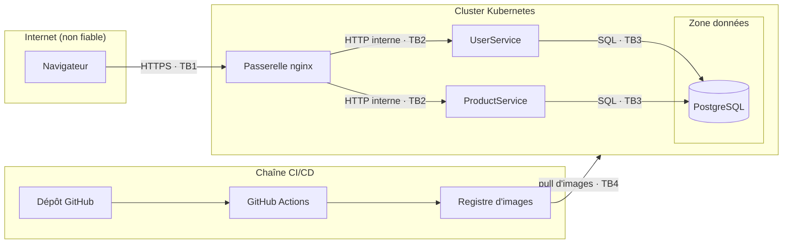

# Modèle de menace (STRIDE)

## 1. Périmètre

AmCart est une boutique en ligne : catalogue, panier, paiement et historique de commandes, avec deux
rôles applicatifs, `customer` et `admin`.

| Composant | Technologie | Rôle |
|-----------|-------------|------|
| Navigateur | SPA React (Vite) | Interface client et administration |
| Passerelle | nginx (image UI) | Sert la SPA, route `/api/*` vers les services |
| UserService | ASP.NET Core 8 | Inscription, connexion, émission des JWT, profils, adresses, contact |
| ProductService | ASP.NET Core 8 | Catalogue, panier, paiement, commandes, avis, liste d'envies |
| PostgreSQL | 16 | Bases `amcart_users` et `amcart_products` |
| CI/CD | GitHub Actions | Build, contrôles de sécurité, publication des images |
| Orchestrateur | Kubernetes (cluster local) | Exécution des conteneurs |

## 2. Actifs à protéger

| Actif | Où il se trouve | Propriété visée |
|-------|-----------------|-----------------|
| Données personnelles des clients (nom, adresse, téléphone, e-mail) | `orders`, `users`, `addresses` | Confidentialité |
| Identifiants (empreintes de mots de passe, jetons de rafraîchissement) | `amcart_users` | Confidentialité |
| Clé de signature JWT | Configuration des deux services | Confidentialité, puis intégrité de l'authentification |
| Identifiants de la base | Configuration des services | Confidentialité |
| Prix et totaux des commandes | `products`, `cart_items`, `orders` | Intégrité |
| Catalogue (fonctions admin) | ProductService | Intégrité |
| Disponibilité du site | Toute la chaîne | Disponibilité |
| Chaîne de build (code, images) | GitHub, registre | Intégrité |

## 3. Acteurs de menace

| Acteur | Accès | Motivation |
|--------|-------|------------|
| Visiteur anonyme | Internet, endpoints publics | Vol de données, fraude |
| Client authentifié malveillant | Jeton `customer` valide | Lire les données d'autrui, payer moins cher |
| Attaquant ayant lu le dépôt public | Code et historique Git | Exploiter des secrets ou des failles connues |
| Dépendance compromise ou vulnérable | Exécutée dans nos images | Compromission par la chaîne d'approvisionnement |

## 4. Flux de données et frontières de confiance

| Frontière | Entre | Ce qui doit y être vérifié |
|-----------|-------|----------------------------|
| TB1 | Internet ↔ passerelle | TLS, en-têtes de sécurité, limitation de débit |
| TB2 | Passerelle ↔ services | Authentification JWT, autorisation par rôle et par objet, validation des entrées |
| TB3 | Services ↔ base | Requêtes paramétrées, compte BDD à privilèges minimaux, segmentation réseau |
| TB4 | CI/CD ↔ cluster | Images scannées, secrets absents des images, contrôle d'admission |

## 5. Analyse STRIDE par composant

Risque = Probabilité × Impact (F = faible, M = moyen, É = élevé).

| Composant | STRIDE | Menace | Faille liée | Risque | Contrôle prévu |
|-----------|--------|--------|-------------|--------|----------------|
| UserService (auth) | **S** | Jetons forgés avec une clé de signature exposée | F5 | É | Secret injecté à l'exécution, rotation, détection de secrets |
| UserService (auth) | **S** | Force brute sur la connexion | — | M | Limitation de débit, alerte sur les échecs de connexion |
| ProductService (recherche) | **T / I** | Injection SQL via le terme de recherche | F1 | É | Requêtes paramétrées, SAST, DAST |
| ProductService (commandes) | **I** | Lecture de la commande d'un autre client | F2 | É | Contrôle de propriété, test de non-régression, DAST |
| ProductService (panier) | **T** | Prix imposé par le client | F3 | É | Prix toujours recalculé côté serveur |
| ProductService (admin) | **E** | Accès aux fonctions admin avec un jeton forgé | F5 | É | Secret externalisé, `[Authorize(Roles="admin")]` |
| Passerelle / UI | **E** | Processus root dans le conteneur | F6 | M | Image non-root, `securityContext`, Kyverno |
| Tous services | **R** | Action sensible sans trace exploitable | — | M | Journaux structurés avec identifiant de corrélation |
| Tous services | **I** | Données sensibles écrites dans les journaux | — | M | Pas de jeton, mot de passe ni PII dans les journaux |
| Tous services | **D** | Saturation par requêtes coûteuses | — | M | Limites de ressources, pagination plafonnée |
| PostgreSQL | **I / T** | Accès direct depuis un pod compromis | — | M | NetworkPolicy en refus par défaut |
| Chaîne CI/CD | **T** | Dépendance vulnérable embarquée | F4 | M | SCA bloquante |
| Chaîne CI/CD | **T** | Image non conforme déployée | F6 | M | Scan d'image, contrôle d'admission |

## 6. Correspondance avec les contrôles du projet

| Exigence | Menaces couvertes |
|----------|-------------------|
| §4.1 Conteneur sécurisé | F5 (pas de secret dans l'image), F6 |
| §4.3 Étape de sécurité bloquante | F1 (SAST), F4 (SCA), F5 (secrets), F6 (image + IaC) |
| §4.4 Gestion des secrets | F5 |
| §4.5 Déploiement durci | F6, mouvement latéral vers la base |
| §4.6 Tests dynamiques | F1, F2, F3 |
| §4.7 Observabilité | Détection de F1 et F2 en exécution, répudiation |

## 7. Limites de ce modèle

- Il ne couvre ni l'infrastructure physique, ni le poste des développeurs, ni le compte GitHub.
- Les risques sont estimés qualitativement. Ce sont des ordres de grandeur, pas des mesures.
- Les fournisseurs OAuth (Google, Facebook, Twitter) sont désactivés dans notre déploiement et sortent
  du périmètre.
